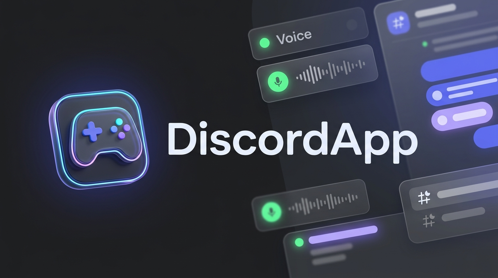
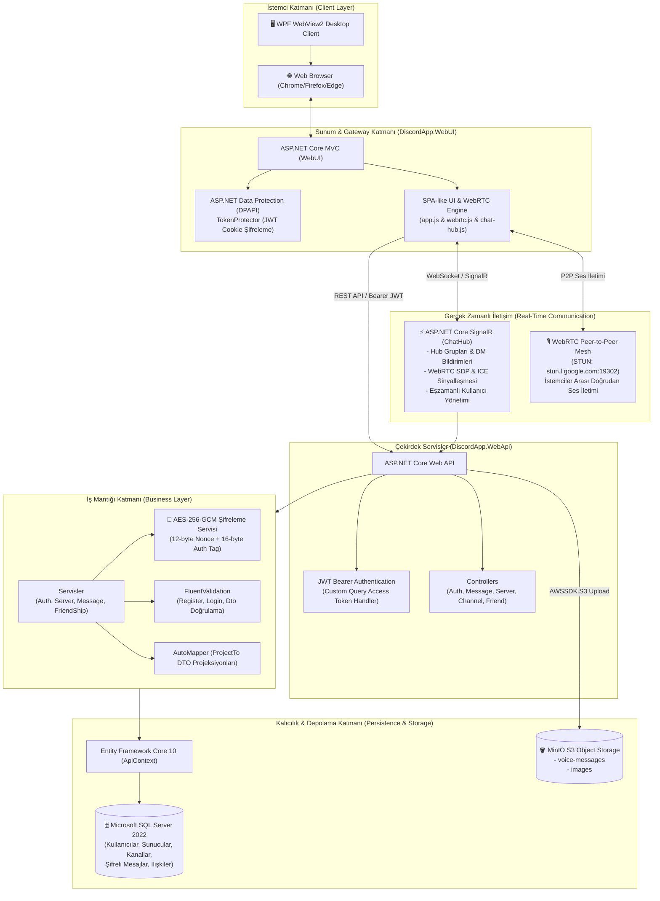
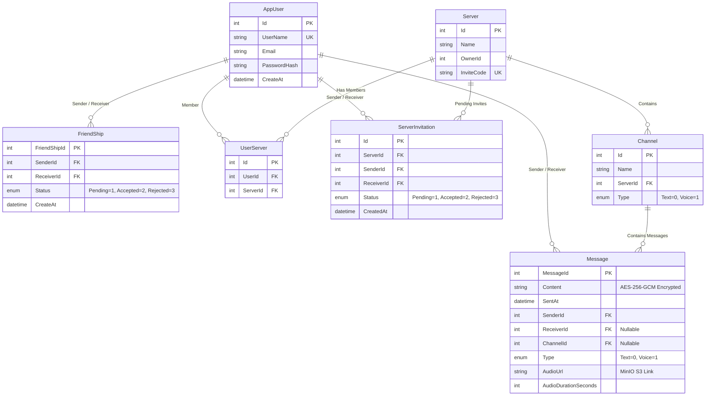

# 🎮 DiscordApp — Dağıtık, Gerçek Zamanlı & Uçtan Uca Şifreli İletişim Platformu

<p align="center">
  
</p>

<p align="center">
  
  
  
  
  
  
  
  
  
  
  
</p>

---

## 📌 İçindekiler
- [Proje Vizyonu ve Genel Bakış](#-proje-vizyonu-ve-genel-bakış)
- [Sistem ve Mimari Tasarımı](#-sistem-ve-mimari-tasarımı)
- [Katmanlı Mimari Analizi (N-Tier Architecture)](#-katmanlı-mimari-analizi-n-tier-architecture)
- [Öne Çıkan Gelişmiş Özellikler](#-öne-çıkan-gelişmiş-özellikler)
  - [1. Kriptografik Güvenlik (AES-256-GCM)](#1-kriptografik-güvenlik-aes-256-gcm-at-rest-şifreleme)
  - [2. WebRTC Eşler Arası (P2P) Ses Kanalları](#2-webrtc-eşler-arası-p2p-mesh-ses-kanalları)
  - [3. SignalR ile Çift Yönlü Gerçek Zamanlı İletişim](#3-signalr-ile-çift-yönlü-gerçek-zamanlı-iletişim)
  - [4. MinIO S3 Dağıtık Nesne Depolama & Sesli Mesajlar](#4-minio-s3-dağıtık-nesne-depolama--sesli-mesajlar)
  - [5. Çift Katmanlı Kimlik ve Çerez Koruması (DPAPI + JWT)](#5-çift-katmanlı-kimlik-ve-çerez-koruması-dpapi--jwt)
  - [6. Hibrit Masaüstü İstemcisi (WPF + WebView2)](#6-hibrit-masaüstü-istemcisi-wpf--webview2)
- [Veritabanı Mimarisi & İlişki Modeli (ERD)](#-veritabanı-mimarisi--ilişki-modeli-erd)
- [Teknoloji Yığını (Tech Stack)](#-teknoloji-yığını-tech-stack)
- [Kurulum ve Çalıştırma Rehberi](#-kurulum-ve-çalıştırma-rehberi)
  - [Gereksinimler](#gereksinimler)
  - [Ortam Değişkenleri (.env)](#ortam-değişkenleri-env)
  - [Docker Compose ile Hızlı Başlangıç (Önerilen)](#docker-compose-ile-hızlı-başlangıç-önerilen)
  - [Yerel Geliştirme Ortamında Çalıştırma (Local Development)](#yerel-geliştirme-ortamında-çalıştırma-local-development)
  - [Desktop Uygulamasının Çalıştırılması](#desktop-uygulamasının-çalıştırılması)
- [REST API Referansı](#-rest-api-referansı)
- [Sürüm Geçmişi & Yol Haritası](#-sürüm-geçmişi--yol-haritası)

---

## 🎯 Proje Vizyonu ve Genel Bakış

**DiscordApp**, popüler iletişim platformu Discord'un temel yeteneklerini ve kullanıcı deneyimini modern bir yazılım mimarisiyle sıfırdan hayata geçiren; **.NET 10 (C# 13)** altyapısı üzerine inşa edilmiş **dağıtık, gerçek zamanlı ve güvenli** bir sesli ve yazılı mesajlaşma ekosistemidir.

Sistem; monolitik sınırların ötesinde modüler katmanlara ayrılmış, veritabanı seviyesinde **AES-256-GCM** authenticated şifreleme uygulayan, istemciler arasında düşük gecikmeli ses iletişimi için **WebRTC Mesh** protokolünü kullanan, medya ve ses kayıtlarını **MinIO S3** nesne depolama havuzunda saklayan ve hem modern **Web tarayıcılarında** hem de **WPF WebView2 Masaüstü uygulamasında** çalışabilen çok platformlu bir çözümdür.

---

## 🏛 Sistem ve Mimari Tasarımı

DiscordApp, **SoC (Separation of Concerns)** ve **Clean Architecture** prensiplerine sadık kalınarak N-Katmanlı mimari deseninde geliştirilmiştir. İstemci etkileşimi, WebSocket/SignalR sinyalleşmesi, RESTful API gateway ve kalıcılık katmanları net bir şekilde ayrıştırılmıştır.



---

## 📂 Katmanlı Mimari Analizi (N-Tier Architecture)

Çözüm (Solution) 6 ana projeden ve açık bir sorumluluk ayrımından oluşur:

| Proje | Hedef Çerçeve | Rol ve Sorumluluklar |
|---|---|---|
| **`Core`** | `net10.0` | Temel domain varlıkları (`AppUser`, `Server`, `Channel`, `Message`, `FriendShip`, `ServerInvitation`) ve sabitler (`ChannelType`, `FriendShipStatus`, `MessageType`). Dış bağımlılık içermeyen domain çekirdeği. |
| **`Data`** | `net10.0` | `ApiContext`, EF Core DbContext yapılandırmaları, Fluent API kuralları, ilişkisel kısıtlamalar (`Restrict` / `Cascade`), Code-First migration geçmişi. |
| **`Business`** | `net10.0` | İş kuralları, `IMessageEncryptionService` (AES-GCM), AutoMapper profilleri, FluentValidation validatörleri, SignalR bildirim köprüleri (`IMessageNotifier`, `IServerNotifier`, `IFriendNotifier`). |
| **`DiscordApp.WebApi`** | `net10.0` | REST API uç noktaları, Swagger/OpenAPI, JWT Authentication middleware, `ChatHub` SignalR hub'ı ve AWS S3 SDK tabanlı `MinioStorageService`. |
| **`DiscordApp.WebUI`** | `net10.0` | Razor MVC arayüzü, DPAPI destekli güvenli çerez oturum yönetimi (`TokenProtector`), dinamik SPA-benzeri JavaScript istemcisi, WebRTC mesh ses motoru ve ses kaydetme arayüzü. |
| **`DiscordApp.Desktop`** | `net10.0-windows` | `Microsoft.Web.WebView2` tabanlı WPF masaüstü uygulaması. WebUI'ı donanım hızlandırmalı yerel bir Windows penceresine entegre eder. |

---

## ⚡ Öne Çıkan Gelişmiş Özellikler

### 1. Kriptografik Güvenlik (AES-256-GCM At-Rest Şifreleme)
Mesajlar veritabanında asla düz metin (plaintext) olarak saklanmaz. `MessageEncryptionService`, modern simetrik şifreleme standardı olan **AES-256-GCM (Galois/Counter Mode)** kullanır:
* **Gizlilik & Bütünlük:** Her mesaj için 12-byte kriptografik rastgele `Nonce` ve 16-byte `Authentication Tag` üretilir.
* **Tamper Koruması:** Mesaj veritabanında değiştirilirse veya bozulursa deşifreleme sırasında `CryptographicException` yakalanır ve bütünlük ihlali bildirilir (`"Bu mesajın bütünlüğü doğrulanamadı."`).
* **Sıfır Gecikme:** Canlı SignalR iletiminde mesaj alıcıya anlık ulaştırılırken, kalıcı veritabanı kaydı şifreli formatta tutulur; geçmiş konuşmalar çekilirken dinamik olarak çözülür.

### 2. WebRTC Eşler Arası (P2P) Mesh Ses Kanalları
DiscordApp, sunucu bant genişliğini tüketmeden ve minimum gecikmeyle ses aktarımı sağlamak için **WebRTC Mesh** mimarisini kullanır:
* **Sinyalleşme (Signaling):** SignalR `ChatHub` üzerinden `SendVoiceOffer`, `SendVoiceAnswer` ve `SendVoiceIceCandidate` metotlarıyla SDP ve ICE adayları eşler arasında taşınır.
* **STUN Desteği:** Google'ın açık STUN sunucusu (`stun:stun.l.google.com:19302`) üzerinden NAT/Firewall arkasındaki eşler birbirine doğrudan bağlanır.
* **Akıllı Mikrofon Kontrolü:** `toggleMic()` fonksiyonu WebRTC bağlantısını koparmadan doğrudan ses track'ini (`track.enabled`) açıp kapatır.
* **Dinamik Eş Yönetimi:** Ses kanalına bir kullanıcı katıldığında mevcut kullanıcılara otomatik çağrı (`callPeer`) başlatılır; kanaldan ayrılma durumunda bağlantılar temizlenir.

### 3. SignalR ile Çift Yönlü Gerçek Zamanlı İletişim
Sistemdeki tüm anlık etkileşimler WebSocket tabanlı ASP.NET Core SignalR ile yönetilir:
* **Kanal Sohbeti:** `#genel` veya özel oluşturulan metin kanallarına `JoinChannel` / `LeaveChannel` ile grup tabanlı anlık mesaj iletimi.
* **1-e-1 Direkt Mesajlar (DM):** Kullanıcı ID'si bazında oluşturulan özel gruplar ile eşzamanlı bildirimler ve okunmamış mesaj rozeti (`has-unread`).
* **Canlı Rozet Güncellemesi:** Bir kullanıcıya arkadaşlık isteği veya sunucu daveti geldiğinde `PendingCountChanged` olayı tetiklenerek bildirim rozeti ve sayfa başlığı (`(1) DiscordApp`) dinamik olarak güncellenir.
* **Otomatik Yeniden Bağlanma:** Bağlantı kesilip tekrar sağlandığında (`onreconnected`), kullanıcının açık olan kanala aboneliği otomatik olarak onarılır.

### 4. MinIO S3 Dağıtık Nesne Depolama & Sesli Mesajlar
Klasik dosya sistemi depolaması yerine, bulut uyumlu **MinIO Object Storage** tercih edilmiştir:
* **Sesli Mesaj Kaydı:** Web arayüzünde HTML5 `MediaRecorder` API kullanılarak `audio/webm;codecs=opus` kalitesinde mikrofon kaydı alınır.
* **S3 Entegrasyonu:** Kaydedilen ses verisi API'ye iletilir, AWS S3 SDK ile `voice-messages` bucket'ına yüklenir ve benzersiz bir GUID ile nesne URL'i üretilir.
* **Inline Oynatıcı:** Canlı sohbette ve kanal geçmişinde sesli mesajlar doğrudan entegre HTML5 `<audio>` çaları ile dinlenebilir.

### 5. Çift Katmanlı Kimlik ve Çerez Koruması (DPAPI + JWT)
XSS ve oturum hırsızlığına karşı yüksek güvenlikli çift katmanlı mimari kurgulanmıştır:
* **JWT & Identity:** Kimlik doğrulama API seviyesinde `Microsoft.AspNetCore.Identity` ve `HMAC-SHA256` imzalı JWT token ile gerçekleştirilir.
* **DPAPI Token Koruma:** WebUI katmanında kullanıcı JWT token'ı doğrudan `localStorage`'da tutulmaz; ASP.NET Core **Data Protection (DPAPI)** ile şifrelenerek `HttpOnly`, `SameSite=Strict` özellikli güvenli çerezde (cookie) saklanır.
* **JwtAccessMiddleware:** İstek geldiğinde korumalı çerez çözülür ve `HttpContext.Items["JwtToken"]` üzerine aktarılarak API ve SignalR bağlantılarına taşınır.

### 6. Hibrit Masaüstü İstemcisi (WPF + WebView2)
Masaüstü deneyimi için geliştirilen `DiscordApp.Desktop`:
* Microsoft'un modern **WebView2 (Chromium)** motorunu barındıran hafif bir WPF kabuğudur.
* Yerel geliştirme sırasında self-signed SSL sertifika uyarılarını otomatik tolere eder (`ServerCertificateErrorDetected`).
* Sayfa yüklenene kadar modern Discord koyu arka planında bekleme ekranı sunar ve bağlantı koptuğunda hata yönetimi sağlar.

---

## 🗄 Veritabanı Mimarisi & İlişki Modeli (ERD)

Aşağıdaki şema, EF Core Code-First ile modellenen ve `ApiContext` üzerinde yapılandırılan ilişkileri göstermektedir:



---

## 🛠 Teknoloji Yığını (Tech Stack)

| Alan | Teknolojiler |
|---|---|
| **Çalışma Zamanı & Dil** | .NET 10.0 (C# 13), ASP.NET Core 10 |
| **ORM & Veritabanı** | Entity Framework Core 10, Microsoft SQL Server 2022 |
| **Gerçek Zamanlı İletişim** | ASP.NET Core SignalR, WebRTC (STUN via Google), WebSockets |
| **Güvenlik & Kriptografi** | AES-256-GCM (`System.Security.Cryptography.AesGcm`), JWT Bearer, ASP.NET Core Data Protection (DPAPI), BCrypt.Net-Next |
| **Nesne Depolama (S3)** | MinIO Object Storage, AWS SDK for .NET (`AWSSDK.S3`), MinIO Client (`mc`) |
| **Validasyon & Eşleme** | FluentValidation (ASP.NET Core entegrasyonlu), AutoMapper |
| **Ön Yüz & Arayüz** | ASP.NET Core Razor Pages / MVC, CSS3 Modern Dark Theme (Discord Palette), Vanilla JS (ES6+), FontAwesome |
| **Masaüstü İstemcisi** | WPF (.NET 10-windows), Microsoft.Web.WebView2 |
| **Konteynerizasyon** | Docker, Docker Compose (Multi-stage build Dockerfiles) |
| **API Dokümantasyonu** | Swagger / OpenAPI (Swashbuckle) |

---

## 🚀 Kurulum ve Çalıştırma Rehberi

### Gereksinimler
* [.NET 10.0 SDK](https://dotnet.microsoft.com/) veya üzeri
* [Docker Desktop](https://www.docker.com/products/docker-desktop/) (Docker Compose v2+)
* Windows 10/11 (Masaüstü WPF uygulamasını derlemek ve çalıştırmak için)

---

### Ortam Değişkenleri (.env)
Proje kök dizininde bulunan Docker Compose orkestrasyonu bir `.env` dosyasına ihtiyaç duyar. Kök dizinde `.env` adında bir dosya oluşturup aşağıdaki anahtarları tanımlayın:

```env
# SQL Server Konfigürasyonu
SA_PASSWORD=YourStrong@Password123!

# MinIO Nesne Depolama Konfigürasyonu
MINIO_ROOT_USER=minioadmin
MINIO_ROOT_PASSWORD=minioadminpassword

# JWT Token Güvenlik Anahtarı (En az 32 karakter)
JWT_KEY=SuperSecretJwtSigningKeyWithSufficientLength2026!

# AES-256-GCM Mesaj Şifreleme Anahtarı (Tam olarak 32 byte - 256 bit Base64)
# PowerShell ile üretmek için: [Convert]::ToBase64String((1..32 | ForEach-Object { Get-Random -Maximum 256 }))
ENCRYPTION_KEY=dGhpcy1pcy1hLXZlcnktc2VjdXJlLTI1Ni1iaXQta2V5MSE=

# ASP.NET Core Geliştirme/Üretim Sertifika Parolası
CERT_PASSWORD=CertSecurePassword2026!
```

---

### Docker Compose ile Hızlı Başlangıç (Önerilen)

Tüm servisleri (**SQL Server 2022**, **MinIO**, **MinIO-Init**, **WebApi**, **WebUI**) tek bir komutla ayağa kaldırabilirsiniz:

```powershell
# 1. Projeyi klonlayın
git clone https://github.com/EfeArdaKaplan/DiscordApp.git
cd DiscordApp

# 2. HTTPS geliştirme sertifikasını dışa aktarın (ilk kez çalıştırılıyorsa)
dotnet dev-certs https -ep ~/.aspnet/https/aspnetapp.pfx -p "CertSecurePassword2026!"
dotnet dev-certs https --trust

# 3. Docker Compose ile tüm servisleri başlatın
docker compose up -d --build
```

Konteynerler ayağa kalktıktan sonra:
* 🌐 **Discord WebUI:** `https://localhost:7200`
* 🔌 **Discord WebApi & Swagger:** `https://localhost:7072/swagger`
* 🪣 **MinIO Konsolu:** `http://localhost:9001` (Kullanıcı: `.env` içindeki değerler)
* 🗄️ **SQL Server:** `localhost:1433`

> [!NOTE]
> WebApi konteyneri ilk başlatıldığında veritabanı migration işlemlerini (`db.Database.Migrate()`) otomatik olarak uygular. `minio-init` konteyneri ise gerekli bucket'ları (`voice-messages`, `images`) otomatik oluşturup yetkilendirir.

---

### Yerel Geliştirme Ortamında Çalıştırma (Local Development)

Docker olmadan doğrudan Visual Studio veya CLI ile geliştirmek isterseniz:

1. **SQL Server ve MinIO'yu Başlatın:**
   Yerel MSSQL/LocalDB ve yerel MinIO sunucunuzun çalıştığından emin olun.

2. **Veritabanı Migration İşlemini Uygulayın:**
   ```powershell
   dotnet ef database update --project Data --startup-project DiscordApp.WebApi
   ```

3. **WebApi Projesini Başlatın:**
   ```powershell
   cd DiscordApp.WebApi
   dotnet run
   ```

4. **WebUI Projesini Başlatın:**
   ```powershell
   cd ../DiscordApp.WebUI
   dotnet run
   ```

---

### Desktop Uygulamasının Çalıştırılması

WPF tabanlı yerel masaüstü istemcisini başlatmak için:

```powershell
cd DiscordApp.Desktop
dotnet run
```
*Masaüstü uygulaması WebView2 altyapısını kullanarak `https://localhost:7200` adresindeki WebUI'ı açar. İstenirse Cloudflare Tunnel veya kendi alan adınız üzerinden dış ağlara yönlendirilebilir.*

---

## 📡 REST API Referansı

| Kategori | Metot | Uç Nokta (Endpoint) | Açıklama | Yetki |
|---|---|---|---|---|
| **Auth** | `POST` | `/api/Auth/Register` | Yeni kullanıcı kaydı oluşturur | Herkese Açık |
| **Auth** | `POST` | `/api/Auth/Login` | Giriş yapar ve JWT Bearer token döner | Herkese Açık |
| **Server** | `GET` | `/api/Server/UserServers` | Kullanıcının üye olduğu sunucuları listeler | `[Authorize]` |
| **Server** | `POST` | `/api/Server/Create` | Yeni sunucu oluşturur (varsayılan `#genel` kanalıyla) | `[Authorize]` |
| **Server** | `GET` | `/api/Server/{serverId}/Members` | Sunucudaki üyeleri listeler | `[Authorize]` |
| **Server** | `GET` | `/api/Server/{serverId}/InviteLink` | Sunucu için 8 karakterli davet kodu üretir | `[Authorize]` |
| **Server** | `POST` | `/api/Server/JoinByInvite` | Davet kodu ile sunucuya katılır | `[Authorize]` |
| **Server** | `POST` | `/api/Server/SendInvitation` | Sunucuya arkadaş davetiyesi gönderir | `[Authorize]` |
| **Channel**| `POST` | `/api/Channel/Create` | Sunucu içinde metin veya ses kanalı açar | `[Authorize]` |
| **Message**| `POST` | `/api/Message/SendDirect` | Arkadaşa AES-256-GCM şifreli direkt mesaj gönderir | `[Authorize]` |
| **Message**| `GET` | `/api/Message/Conversation/{id}` | İki kullanıcı arasındaki şifreli geçmişi çözer ve döner | `[Authorize]` |
| **Message**| `POST` | `/api/Message/SendChannel` | Sunucu kanalına şifreli mesaj gönderir | `[Authorize]` |
| **Message**| `GET` | `/api/Message/ChannelMessages/{id}`| Kanal mesaj geçmişini döner | `[Authorize]` |
| **Message**| `POST` | `/api/Message/SendVoice` | Ses kaydını MinIO S3'e yükler ve sesli mesaj iletir | `[Authorize]` |
| **Friend** | `GET` | `/api/FriendShip/Search` | Kullanıcı adına göre arama yapar | `[Authorize]` |
| **Friend** | `POST` | `/api/FriendShip/SendRequest` | Arkadaşlık isteği gönderir | `[Authorize]` |
| **Friend** | `GET` | `/api/FriendShip/PendingRequests` | Bekleyen arkadaşlık isteklerini listeler | `[Authorize]` |
| **Friend** | `POST` | `/api/FriendShip/Respond` | Arkadaşlık isteğini kabul eder veya reddeder | `[Authorize]` |

---

## 🗺 Sürüm Geçmişi & Yol Haritası

### 📜 Sürüm Geçmişi (Release History)
* **`v1.0.1.Alpha`** — Kullanıcı deneyimi iyileştirmeleri, davet sistemi optimizasyonları ve hata düzeltmeleri.
* **`v1.0.0.Alpha`** — Dockerize sürüm: Multi-stage Dockerfile'lar, Docker Compose orkestrasyonu, MinIO otomatik bucket başlatıcısı (`minio-init`) ve otomatik migration entegrasyonu.
* **`v0.9.7`** — MinIO S3 tabanlı sesli mesajlaşma (Opus/WebM ses kaydı, S3 depolama ve inline oynatıcı).
* **`v0.8.5`** — Veritabanı seviyesinde AES-256-GCM mesaj şifreleme & SignalR anlık bildirim rozetleri.
* **`v0.8.4`** — WebRTC dinamik mesh ses kanalları ve sinyalleşme protokolü.

### 🔮 Gelecek Yol Haritası (Roadmap)
- [ ] **SFU (Selective Forwarding Unit) Entegrasyonu:** WebRTC Mesh yapısının 4+ kişilik odalarda bant genişliği kısıtını aşmak için MediaSoup/LiveKit SFU mimarisine geçiş.
- [ ] **Ekran & Kamera Paylaşımı:** WebRTC üzerinden video akışı ve ekran paylaşımı desteği.
- [ ] **Gelişmiş Rol & İzin Yönetimi (RBAC):** Sunucu içi özel roller (Yönetici, Moderatör, Üye) ve kanal bazlı okuma/yazma izinleri.
- [ ] **Çoklu Medya Gönderimi:** Resim, GIF, video ve genel dosya eklerinin MinIO üzerinden doğrudan sohbete yüklenmesi.
- [ ] **Mobil İstemci:** .NET MAUI tabanlı Android ve iOS istemcisi.

---

<p align="center">
  Geliştirici: <b>Efe Arda KAPLAN</b> • 2026 • <i>Açık Kaynak Kodlu Discord Klon Projesi</i>
</p>
